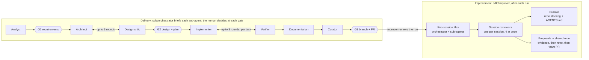

# Agentic SDLC — Handoff

Oct 3, 2026 · @Jasper Koenig

## Purpose and status

The project is a team-shared set of Kiro agents and skills for human-in-the-loop agentic software development, now at v3. v3 is designed and written but has not been run against a real Kiro install or a real repo.

The user works alone in the loop but sits in a larger team that reviews PRs, does other work, and reads produced docs. Kiro CLI is the primary runtime; Claude Code compatibility is a secondary goal.

The deliverable is `agentic-sdlc-v3.zip` (95 files), with two folders: `sdlc-agents/` (the shared team repo) and `repo-scaffold/` (copied into each product repo). `CHANGES-v3.md` summarises v2 to v3.

**What the next agent should do first**

1. Read `CHANGES-v3.md`, then `sdlc-agents/README.md`, then `agents/orchestrator.md` and `skills/sdlc-run-orchestration/SKILL.md`.
2. Help the user work through the "Verify on your Kiro version" checklist (Section: Unverified assumptions). Fix files where Kiro behaves differently.
3. Support a first real run on a small ticket, then a first `review run` with the improver, and fold the findings back in.

## Goals and requirements

These are the user's stated requirements, in the order they emerged. Later ones override earlier ones where they conflict.

| # | Requirement | Source turn |
| --- | --- | --- |
| 1 | A refined, mostly automated flow with a human in the loop, explicitly short of a "dark factory" | 1 |
| 2 | Good planning, application of design principles, and domain knowledge of the application | 1 |
| 3 | Verification of design and implementation, with a loop that continuously improves | 1 |
| 4 | Automatic improvement of SOPs and agent prompts with new approaches and processes | 1 |
| 5 | Works on an existing codebase; one person in the loop, inside a larger team | 2 |
| 6 | Gathered context is stored where the whole team benefits, not in one programmer's local folder | 3 |
| 7 | The improver reviews the full threads of other agents to find inefficiencies and mistakes | 3 |
| 8 | Agent files and SOPs live in their own team-shared repo; repo-specific context (what is where, build commands, odd dependencies) lives in each product repo | 4 |
| 9 | No scripts that interpret things, and no subverting Kiro's sub-agent model, because that breaks other workflows | 4 |
| 10 | Instructions are positive and specific; the improver knows this and writes that way | 4 |
| 11 | Interaction model: start the orchestrator with a ticket, plan with it, then it calls other agents for each stage with the human in the loop | 4 |

## Version history

Three versions were built; v3 is current. v2's runner-and-scripts approach was rejected by the user and must not be reintroduced.

| Version | What it was | Why it changed |
| --- | --- | --- |
| v3 (current) | Two repos. Kiro Markdown agents in `~/.kiro/agents/sdlc/`, SOPs as Agent Skills, native sub-agents and review loops, orchestrator-led co-planning, improver reading Kiro's native session store, positive-instruction writing guide | Built to meet requirements 8–11 |
| v2 | Single repo with `agentic/` folder; a Python runner (`flow`) running each stage headless with `--output-format stream-json`; `transcript.py` parser and redactor; `roles.json` generating Kiro and Claude agent configs; `context_guard.py` in CI | User rejected: process files belong in their own repo, and scripts that interpret things or bypass Kiro's sub-agent model break other workflows |
| v1 | Seven agents as Kiro JSON configs in `.kiro/agents/`, SOPs in `process/sops/`, steering in `.kiro/steering/`, LLM orchestrator, process-engineer reading structured traces only | Knowledge sat in per-tool folders; improver couldn't see full threads; the workflow contract was always-on steering, which would leak into teammates' ordinary sessions |

**Ideas from v2 that survived into v3:** the finding taxonomy, reason codes, ID'd context entries edited as deltas (ACE), KEEP findings, evidence thresholds (3+ instances across 2+ runs), a cap on prompt changes per retro, and checking each change's effect after later runs.

**Ideas from v2 that were dropped:** headless capture, transcript parsing and stats scripts, config generation, the context-guard CI check, redaction tooling, `flow replay` with git worktrees, and the golden-run eval set. A later agent could revisit replay and golden runs in a native form if the user wants them.

## Current architecture (v3)

Shared process lives in one team repo; repo knowledge lives in each product repo; everything runs on native Kiro features.

**Where things live**

| Location | Contents | Changed by |
| --- | --- | --- |
| `sdlc-agents/` repo, cloned to `~/.kiro/sdlc`, with `~/.kiro/agents/sdlc` symlinked to its `agents/` | 10 agents, 12 skills (procedures, templates, taxonomy, reason codes), `proposals/` (open, accepted, rejected, metrics.md), CHANGELOG | Team PRs |
| Product repo | `AGENTS.md`, `CLAUDE.md` (imports AGENTS.md and steering), `.kiro/steering/` (project, architecture, domain, principles as always-on; domain-rules as auto), module `AGENTS.md` files, `docs/adr/` | Normal PRs; curator's updates ship with the code |
| Product repo, per run | `.kiro/specs/<slug>/`: run-log, requirements, design, tasks, design-review, plan, verification-T-n, pr, context-delta, reviews/ | Agents during a run |
| `~/.kiro/sessions/` (local, owner-only) | Kiro's own record of the orchestrator session and every sub-agent session | Kiro itself; read by improver and session-reviewer |

**Agents** (invoked as `sdlc/<name>`)

| Agent | Role | Sub-agents it may call |
| --- | --- | --- |
| orchestrator | Run lead; plans with the human, briefs sub-agents, stops at checkpoints, records decisions | all `sdlc/*` |
| analyst | Researches code and domain; drafts requirements with open questions and defaults | none |
| architect | design.md, tasks.md, ADRs, grounded in existing code and principles | none |
| design-critic | Independent findings by severity; ends NEEDS\_CHANGES on blockers | none |
| implementer | One task, tests first, local commits | none |
| verifier | Independent check of one task's diff; may add tests, not product code | none |
| documentarian | Docs, ADR status, changelog, runbooks, pr.md | none |
| curator | Verified, ID'd delta updates to steering and AGENTS.md; bootstrap mode for new repos | none |
| session-reviewer | Hindsight review of one session file | none |
| improver | Run review (fans out session-reviewers, routes findings) and retro (ranks proposals, drafts diffs) | session-reviewer, curator |

**Skills:** sdlc-run-orchestration, sdlc-intake, sdlc-design, sdlc-design-review, sdlc-implement, sdlc-verify, sdlc-document, sdlc-curate-context, sdlc-review-session, sdlc-improve-process, sdlc-writing-instructions, sdlc-design-principles. Agents reference them with `skill://~/.kiro/sdlc/skills/<name>/SKILL.md`; templates sit in each skill's `references/`.

**Gates:** G1 requirements, G2 design plus plan (the human chooses checkpoints: per task, after all tasks, or before PR only), G3 branch plus PR description plus context delta. Review loops cap at 3 rounds for architect/critic and for implementer/verifier.

Delivery runs inside one orchestrator conversation; afterwards the improver reviews each recorded session and routes fixes to repo context or to shared proposals.

## Key design decisions

Each decision below is settled unless the user reopens it; the rationale is what a successor needs to keep changes consistent.

| Decision | Rationale |
| --- | --- |
| Two repos: shared process vs in-repo context | User requirement 8. Team-wide agents improve once for everyone; repo facts stay versioned with the code they describe |
| Install shared repo at `~/.kiro/sdlc` and symlink `agents/` to `~/.kiro/agents/sdlc` | Kiro names agents by path under the agents directory (`sdlc/planner`), giving a namespace. Cloning the whole repo into the agents dir would make every Markdown file an agent |
| Kiro Markdown agent format (frontmatter + body) | Equivalent to JSON per Kiro docs, readable for long prompts, and the format the IDE discovers |
| SOPs as Agent Skills | Progressive disclosure keeps context lean; skills double as slash commands; the format is portable to Claude Code |
| Native sub-agents and review loops; no scripts | User requirement 9. Each sub-agent gets its own context, permissions, and session record |
| Orchestrator co-plans, then delegates | User requirement 11. The human picks checkpoints in plan.md; stages are tailored (bug fix vs feature vs spike) |
| Orchestrator records `/session-id` and process version in run-log.md | The only reliable link from a run to its session files; the process version lets reviewers read the instructions that were in effect |
| Improver fans out one session-reviewer per session, up to 4 in parallel; orchestrator thread reviewed too | Keeps each reviewer's context focused; the orchestrator's briefs shape every other stage |
| Findings routed two ways: repo gaps to curator, process gaps to proposals in the shared repo | Each fix lands where it applies; teammates' evidence accumulates on the same proposal |
| Proposals are append-only evidence files; ready at 3+ instances across 2+ runs | Avoids reacting to one incident; cross-person evidence is strongest |
| Up to 3 agent/skill-step changes per retro | Makes each change's effect attributable in later reviews |
| Context as ID'd entries edited by add/amend/deprecate; split into module AGENTS.md rather than summarise | ACE research: rewrites collapse context; specifics carry the value |
| Hard limits in permission rules; prompts describe the positive workflow | User requirement 10, plus enforcement that prompt text can't give |
| Positive-instruction guide as its own skill, plus finding code IN-NEGATIVE | Makes the user's tip a working method for improver, curator, reviewers, and humans, and measurable |
| Gates, permissions, and safety rules stay human decisions | The improver describes evidence; the team decides |

## Research sources

Kiro documentation drove the mechanics; three research and guidance sources drove the improvement-loop design. Kiro docs change often, so recheck them before relying on a detail.

| Source | What it contributed |
| --- | --- |
| [Kiro: Agent configuration reference](https://kiro.dev/docs/custom-agents/configuration-reference/) | Fields, `prompt` as `file://`, `resources` with `file://` and `skill://`, permissions with allow/ask/deny and deny-overrides, hooks, default resource inheritance and `chat.disableInheritingDefaultResources` |
| [Kiro: Custom agents](https://kiro.dev/docs/custom-agents/) and [CLI v3 agent config](https://kiro.dev/docs/cli/v3/agent-config/) | Markdown agent format; `~/.kiro/agents/team/planner.md` becomes `team/planner` |
| [Kiro: Invoking as sub-agents](https://kiro.dev/docs/custom-agents/subagents/) | Isolation, inheritance table, review loops (trigger, target, max\_iterations 1–10), `availableAgents` / `trustedAgents`, orchestrator needs the `subagent` tool |
| [Kiro: Subagents (chat)](https://kiro.dev/docs/chat/subagents) | Sub-agents don't see Specs; hooks don't fire in sub-agents; Markdown custom sub-agents |
| [Kiro: Agent Skills](https://kiro.dev/docs/skills/) | SKILL.md format, progressive loading, `skill://` with home expansion, custom agents must list skills explicitly |
| [Kiro: Steering](https://kiro.dev/docs/steering/) | Inclusion modes (always, fileMatch, manual, auto), `#[[file:…]]` references, AGENTS.md support including subdirectories |
| [Kiro: ACP](https://kiro.dev/docs/cli/acp) and [Session management](https://kiro.dev/docs/cli/chat/session-management/) | Session storage under `~/.kiro/sessions/`, `/session-id`, `/transcript save`, `--resume-id`, owner-only access |
| [kiro-session-index (PyPI)](https://pypi.org/project/kiro-session-index/) | Two on-disk layouts: V3 directory format with `sub-executions/`, and the three-file `cli/<id>.json/.jsonl/.lock` format |
| [ao-plugin-agent-kiro](https://github.com/codeatlasdev/ao-plugin-agent-kiro) | Sub-agent calls create additional ACP session files with the same cwd |
| [Kiro: Workflows](https://kiro.dev/docs/workflows/) and [Introducing workflows](https://kiro.dev/blog/introducing-workflows/) | Background, pausable multi-step runs; noted as a possible future option, not used |
| [Kiro: Headless mode](https://kiro.dev/docs/cli/headless/) | Basis for v2's runner (now dropped); `KIRO_API_KEY` needs a Pro tier or above |
| [GEPA (arXiv 2507.19457)](https://arxiv.org/abs/2507.19457) | Reflection on full execution traces beats scalar rewards for prompt improvement; the reflection model must be strong |
| [ACE: Agentic Context Engineering (arXiv 2510.04618)](https://huggingface.co/papers/2510.04618) | Contexts as evolving playbooks; itemized delta updates prevent context collapse and brevity bias |
| [Anthropic: Effective context engineering](https://www.anthropic.com/engineering/effective-context-engineering-for-ai-agents) | Just-in-time context, structured notes, sub-agents with clean context windows |
| [Anthropic: Be clear, direct, and detailed](https://docs.anthropic.com/en/docs/be-clear-direct) | "Brilliant but very new employee" framing; give context, be specific, sequential steps — basis of sdlc-writing-instructions |

## Unverified assumptions

None of v3 has run on a real Kiro install; these are the points most likely to need fixes, in the order to check them. The same list is in the `sdlc-agents` README.

- [ ] `kiro-cli agent list` shows `sdlc/orchestrator` and the other nine via the symlinked sub-directory.
- [ ] The frontmatter fields used (`tools`, `allowedTools`, `toolsSettings.subagent`, `permissions.rules` with `exclude`, `resources`, `welcomeMessage`) are accepted in Markdown agents.
- [ ] Relative `file://AGENTS.md` and `file://.kiro/steering/**/*.md` resolve from the workspace for global agents.
- [ ] `skill://~/.kiro/sdlc/skills/...` expands home and the named skill activates when the prompt names it.
- [ ] The `availableAgents: ["sdlc/*"]` glob matches namespaced agents.
- [ ] Deny rules hold inside sub-agents (ask the verifier to edit a source file; expect a refusal).
- [ ] Permission `match` patterns starting with `~/` work for `fs_read` / `fs_write` (improver, session-reviewer).
- [ ] Which session layout this Kiro version writes, and that sub-agent sessions are findable from the parent (see `locating-sessions.md`).
- [ ] Whether custom agents inherit steering automatically; if steering loads twice, set `chat.disableInheritingDefaultResources`.
- [ ] The orchestrator can run `git -C ~/.kiro/sdlc log` to record the process version (it is not in its shell allow-list yet; add it or have the human paste the version).

## Open questions and next steps

The next milestone is one real end-to-end run plus its review; most open questions resolve there.

**Next steps**

- [ ] Run the verification checklist above and patch agent frontmatter, resource paths, or `locating-sessions.md` as needed.
- [ ] Add `git -C ~/.kiro/sdlc log*` to the orchestrator's shell allow-list.
- [ ] Replace the placeholder examples in `sdlc-design-principles` with real ones from the team's code.
- [ ] Bootstrap one product repo with `sdlc/curator`; have the user verify the DRAFT entries.
- [ ] Run a small ticket through `sdlc/orchestrator` with "after each task" checkpoints.
- [ ] Run `sdlc/improver` with `review run <slug>`; check reviews cite line numbers and route findings correctly.
- [ ] Adjust skills from that first review, following `sdlc-writing-instructions`.

**Open questions for the user**

- Should session reviews (which quote product details) be committed in the product repo under `.kiro/specs/<slug>/reviews/`, or kept local?
- Which models should the session-reviewer and improver use? Research suggests the strongest available; Kiro model ids weren't checked.
- Is a Claude Code version of the agents wanted now? Skills are portable; agent files would need thin `~/.claude/agents/` equivalents.
- Is the PR/ticket system reachable by MCP (e.g. Jira, GitHub)? The orchestrator could pull tickets and the improver could pull PR comments instead of the human pasting them.
- Should Kiro Workflows replace sub-agent delegation once available on the user's account? It offers pausable, steerable background steps.
- Would a native form of replay or golden-run checks (dropped with v2's scripts) be useful for testing proposals before merging?

## Conventions for continuing

Keep every change native to Kiro, positive in wording, and placed in the home where it applies.

- **Write instructions** per `skills/sdlc-writing-instructions`: say what to do, be specific, give the reason, calm emphasis, one home per behaviour. Run its self-check before finishing; grep for "don't", "never", "avoid", "must not" and rewrite each as the positive behaviour.
- **Put limits in permissions**, not prose: push, merge, rebase, `rm -rf`, and write scopes are deny or allow rules in agent frontmatter.
- **Use native mechanisms only:** Markdown agents, skills, sub-agents, review loops, steering, AGENTS.md, Kiro's session store. Add no runner, parser, generator, or hook script unless the user asks.
- **Choose the home for a change:** team-wide behaviour goes in an agent file or skill in `sdlc-agents`; anything true of one repo goes in that repo's steering or a module AGENTS.md.
- **Pick the lightest layer that fixes a pattern:** brief template, then skill reference or template, then skill step, then agent file.
- **Edit context as deltas:** ID'd entries; add, amend in place keeping the id, or deprecate with a reason; split large files rather than summarise.
- **Keep ids stable:** finding codes, reason codes, principle ids (P-01…), and context ids are counted across runs. New codes go through a proposal.
- **Version the process:** bump `CHANGELOG.md` with what changed and which finding codes it targets, so retros can check the effect.
- **Check Kiro docs** before assuming a field or behaviour; the docs were updated during this conversation and some pages disagree (for example, whether custom agents inherit steering).
